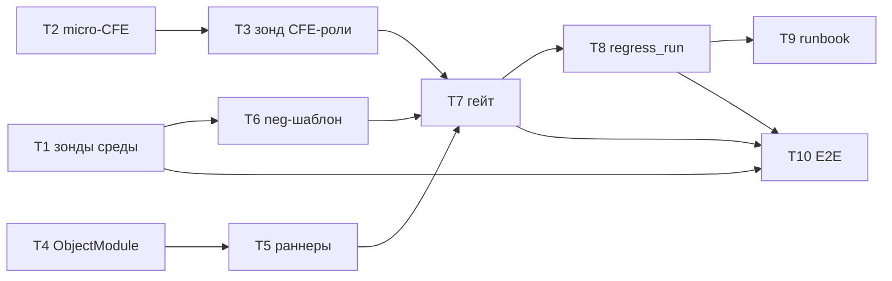

# Tasks: Спека 004 — Реальные авторы + негативные сценарии

> Requirements: @requirements.md
> Design: @design.md
> Status: Approved (night-delegation 2026-10-19, как design.md)
> Last Updated: 2026-10-19

## Requirement Coverage

| Requirement | Tasks | Notes |
|-------------|-------|-------|
| FR-001 | T7, T8 | real-ветка гейта + флаг/манифест |
| FR-002 | T4, T5, T10 | подмена всегда + обе ветки восстановления + finally-дрилл |
| FR-003 | T8, T7 | два рубежа rac |
| FR-004 | T1, T6, T7 | neg-состав (5 ролей) + neg-батч; micro-CFE исключён по фактам |
| FR-005 | T1, T4, T6 | ПАТТЕРНОТКАЗА («Нарушение прав доступа») + инверсия вердикта |
| FR-006 | T4, T8 | pwdSubstituted/restored per-user, негатив-флаг |
| FR-007 | T8, T10 | baseline-real.json + зелёность |
| FR-008 | T9 | runbook |
| FR-009 | T9 | пометка Could Have |
| NFR-001 | T10 | замер фактом |
| NFR-002 | T4, T7 | булевы факты, .gitignore, VAParams |
| NFR-003 | T4, T7, T10 | 3 уровня finally + guard + краш-дрилл |
| NFR-004 | T8 | консольная сводка |

## Implementation Readiness Check

| Check | Status | Notes |
|-------|--------|-------|
| Must Have requirements have tasks | Pass | FR-001..005 все покрыты |
| Tasks map to requirements/design | Pass | TD-001..007 ↔ T4..T9 |
| Critical Questions answered | Pass | Q-001..003 в requirements; зонды — T1/T3 |
| Dependencies/AC/files/verification у задач | Pass | |
| Verification commands identified | Pass | bsl-ls, pre_load_validate, py-тесты, E2E main-агент |
| No blocking gaps | Pass | блокер-зонд CFE-роли изолирован в T3 с fallback |

## Task Summary

| Task | Title | Priority | Estimate | Dependencies | Status |
|------|-------|----------|----------|--------------|--------|
| T1 | Зонды среды: rac-формат, XML-аудит БазовыеПраваБСП, neg-состав, ПАТТЕРНОТКАЗА | P0 | 1h | none | **done** (факты `tmp/s004/facts-probe-env.md`, `facts-neg-composition.md`) |
| ~~T2~~ | ~~micro-CFE АпкСценТестНегРоль~~ — ОТМЕНЁН по фактам (neg-роль не нужна) | — | — | — | cancelled |
| ~~T3~~ | ~~Зонд-блокер CFE-роли~~ — неактуален (micro-CFE исключён) | — | — | — | cancelled |
| T4 | ObjectModule.bsl: ПодменитьПарольБезусловно, ветка восстановления, флаг батча, guard, отчёт | P0 | 2h | none | pending |
| T5 | Раннеры (target + t6-зеркало): ветка подмены, pwdSubstituted, пересборка, smoke зондового режима | P0 | 2h | T4 | pending |
| T6 | neg-шаблон neg-pl-denied.feature (запись/проведение ПЛ) | P1 | 1h | T1 | pending |
| T7 | t8_gate.py: real-ветка (skip restrict, smoke-нормализация, neg-пользователь, verify_real) | P0 | 2h | T5 | pending |
| T8 | regress_run.py: --real-authors, rac_sessions_online, guard-check, BASELINE_REAL, отчёт | P0 | 2h | T7 | pending |
| T9 | runbook FR-008 + FR-009 | P1 | 30m | T8 | pending |
| T10 | E2E: rehearsal real-authors + baseline-dt, краш-дрилл, чистый повтор, NFR-001, --set-baseline | P0 | 3h | T4..T9 | pending |

## Task T1: Зонды среды (rac-формат, аудит роли, предварительный отказ)

**Priority:** P0 **Estimate:** 1h **Dependencies:** none
**Covers:** FR-003, FR-005 **Status:** pending

### Work
- [ ] rac session list: формат user-name ↔ имя ИБ, infobase-uuid, пустые user-name у сервисных; факт в `tmp/s004/facts-probe-env.md` (cp866 → utf-8 файлом)
- [ ] XML-аудит `БазовыеПраваБСП` (APKModSrc): отсутствие Insert/Update/Post на `Document.Апк*`; Read фиксируется
- [ ] Временный zTemp-пользователь только с `БазовыеПраваБСП`: попытка проведения ПЛ (COM) → фактический текст ошибки (предварительный ПАТТЕРНОТКАЗА); finally-очистка + верификация CLEAN

### Acceptance Criteria
- [ ] facts-файл: rac-формат подтверждён примером
- [ ] Права БазовыеПраваБСП по Document.Апк* — факт (что есть/нет)
- [ ] Текст ошибки отказа зафиксирован байт-точно (utf-8)

### Files
- `tmp/s004/probe-env-*.py`, `tmp/s004/facts-probe-env.md` — create

### Verification
- [ ] Верификационный скрипт: zTemp-* отсутствуют в базе (CLEAN)
- [ ] 2-attempt stop на каждом зонде

## Task T2: micro-CFE АпкСценТестНегРоль

**Priority:** P0 **Estimate:** 1.5h **Dependencies:** none
**Covers:** FR-004 **Status:** pending

### Work
- [ ] Scaffold `src/cfe/АпкСценТестНегРоль/` (cfe-init): Configuration.xml + Roles/АпкСценТестНегатив + пустой Ext/Rights.xml по образцу 5-строчных (write-tool, uuid фиксируется)
- [ ] `pre_load_validate.py` → db-load-xml (Mode Full, +UpdateDB) → round-trip verify (compare_dump_dirs) → db-cfe-admin «проверка применимости»

### Acceptance Criteria
- [ ] Расширение в базе, роль АпкСценТестНегатив существует, Rights.xml пустой
- [ ] Round-trip: content diff REAL отсутствует

### Files
- `src/cfe/АпкСценТестНегРоль/**` — create

### Verification
- [ ] pre_load_validate exit 0; db-load-xml OK; round-trip OK; применимость OK

## Task T3: Зонд-блокер — роль CFE из COM

**Priority:** P0 **Estimate:** 1h **Dependencies:** T2
**Covers:** FR-004, FR-005 **Status:** pending

### Work
- [ ] Из COM-Предприятия: видна ли роль расширения в `Метаданные.Роли`; назначается ли `u.Роли.Добавить(<роль CFE>)` (+ БазовыеПраваБСП), состав после `Записать()`
- [ ] Полный neg-состав: TestClient-вход без модальных окон; финальный ПАТТЕРНОТКАЗА (если отличается от T1)
- [ ] 2 неудачи → решение fallback: роль в основной конфигурации (APKModSrc + db-load-xml), факт в `tmp/s004/facts-cfe-role.md`

### Acceptance Criteria
- [ ] Вердикт: CFE-роль назначаема ДА/НЕТ (+ доказательство)
- [ ] ПАТТЕРНОТКАЗА зафиксирован для полного neg-состава

### Files
- `tmp/s004/probe-cfe-role-*.py`, `tmp/s004/facts-cfe-role.md` — create

### Verification
- [ ] zTemp-* CLEAN после зондов

## Task T4: ObjectModule.bsl — механизм паролей + отчёт

**Priority:** P0 **Estimate:** 2h **Dependencies:** none
**Covers:** FR-002, FR-005, FR-006, NFR-002/003 **Status:** pending

### Work
- [ ] НОВЫЙ экспорт `ПодменитьПарольБезусловно` (после ~701): замороженный `ПодменитьПароль` as-is; при НЕ ПарольУстановлен → `Пароль=Тестовый; Записать()`; снимок+`УстановленТестовый`
- [ ] `ВосстановитьПароль` (~712): ветка ПарольУстановлен=Ложь → `Пароль=""; Записать()` + верификация; поле `ПарольВосстановлен` (fallback `ХэшВосстановлен`)
- [ ] `ПодготовитьПрогон` (~624): настройка `alwaysSubstitutePwd`; `Батч.ПодменятьПароль = ПарольУстановлен ИЛИ ВсегдаПодменять`; guard-файл `tests/pwd-guard/<user-latin>.json` до подмены (active=true), сброс active=false после успешного restore
- [ ] `СобратьОтчет`: pwdSubstituted/passwordRestored per-batch; инверсия негативного вердикта (ПАТТЕРНОТКАЗА из T1/T3: neg-pass / neg-fail «неожиданно прошло» / «чужая ошибка» / «среда»); раздел позитив/негатив
- [ ] Гейты: pre_load_validate → `bsl-ls bsl_analyze` (0 файлов = НЕ выполнено) → epf-build

### Acceptance Criteria
- [ ] bsl-ls: 0 ошибок по изменённым модулям
- [ ] EPF пересобран; замороженный ПодменитьПароль байт-в-байт (git diff подтверждает)

### Files
- `src/АпкПодготовкаСценарныхТестов/Ext/ObjectModule.bsl` — modify
- `tests/pwd-guard/.gitkeep`; `.gitignore` (+tests/pwd-guard/)

### Verification
- [ ] py-юнит-проверки формата guard (если применимо); bsl-ls; сборка

## Task T5: Раннеры — ветка подмены в оба модуля форм

**Priority:** P0 **Estimate:** 2h **Dependencies:** T4
**Covers:** FR-002, FR-006 **Status:** pending

### Work
- [ ] target `Forms/Форма/Ext/Form/Module.bsl`: ветка по `Батч.ПодменятьПароль` → `Сервер_ПодменитьПарольБезусловно`; `pwdSubstituted` в Результат; сервер-обёртка
- [ ] t6-зеркало `АпкРаннер/.../Module.bsl`: то же зеркально
- [ ] bsl-ls оба; пересборка обоих EPF; smoke зондового режима (зондовый путь — нулевой дифф, rehearsal без --real-authors зелёный)

### Acceptance Criteria
- [ ] Оба EPF пересобраны, bsl-ls чист
- [ ] Зондовый rehearsal: exit 0, зондовый путь не изменился

### Files
- `src/АпкПодготовкаСценарныхТестов/Forms/Форма/Ext/Form/Module.bsl` — modify
- `tmp/t6/runner_src/АпкРаннер/Forms/Форма/Ext/Form/Module.bsl` — modify

### Verification
- [ ] bsl-ls; epf-build; rehearsal (main-агент, эксклюзивно)

## Task T6: neg-шаблон neg-pl-denied.feature

**Priority:** P1 **Estimate:** 1h **Dependencies:** T1
**Covers:** FR-004, FR-005 **Status:** pending

### Work
- [ ] `tests/templates/neg-pl-denied.feature`: навигация → создание ПЛ → запись/проведение (шаги из 01/02-* живых фич; НЕ открытие формы); сценарий честно красный; латиница в имени, русский текст внутри (write-tool)

### Acceptance Criteria
- [ ] Шаблон парсится препроцессингом; плейсхолдеры совместимы с живыми фичами

### Files
- `tests/templates/neg-pl-denied.feature` — create

### Verification
- [ ] Прогон генерации (stage-a) включает neg-фичу без ошибок препроцессинга

## Task T7: t8_gate.py — real-ветка

**Priority:** P0 **Estimate:** 2h **Dependencies:** T2, T3, T5
**Covers:** FR-001, FR-003, FR-004, NFR-002/003 **Status:** pending

### Work
- [ ] Чтение режима из настроек (realAuthors); логирование режима первой строкой
- [ ] Real-ветка: без create_user(Зонд*), без restrict_manifest; smoke-нормализация под первым автором (D-003); add_negative_batch (формат restrict_manifest, `"negative":true`); create_neg_user (negUserRoles, ЗОД off, пароль в памяти); rac re-check после Stage A; record_authors_state/verify_real (COM-снимок авторов до/после Stage B); mode-зависимый finally (neg-пользователь: 2 попытки + переподключение); verify_real (neg rs!=0 И все neg-pass; все passwordRestored)
- [ ] Зондовый путь — нулевой дифф (проверить git diff)

### Acceptance Criteria
- [ ] Без realAuthors: поведение/код зондового пути идентичны (diff только аддитивный)
- [ ] С realAuthors: манифест не рестриктится, neg-батч добавлен

### Files
- `scripts/t8_gate.py` — modify

### Verification
- [ ] py-юнит dry-run веток (моки COM) или E2E T10

## Task T8: regress_run.py — флаг, preflight, baseline, отчёт

**Priority:** P0 **Estimate:** 2h **Dependencies:** T7
**Covers:** FR-001, FR-003, FR-006, FR-007, NFR-004 **Status:** pending

### Work
- [ ] `--real-authors` (mutex `--web-client`); patch_settings_for_real (backup/restore finally); `rac_sessions_online()` (cp866, allowlist {Администратор (ОрловАВ)}+пустые) — preflight exit 2 ДО дампа; guard-check (активные снимки → отказ+runbook)
- [ ] BASELINE_REAL + параметризация read/write_baseline; зелёность режима (позитивы + negativePassed + все passwordRestored); effective-status для негативов в diff
- [ ] build_report: строка режима, колонки pwdSubstituted/passwordRestored, негатив-флаг из манифеста, раздел «Авторы и восстановление», totals негативов; консольная сводка NFR-004

### Acceptance Criteria
- [ ] py-тесты: mutex, guard-check, зелёность, отчёт-формат
- [ ] Без флага: нулевой дифф поведения зондового режима

### Files
- `scripts/regress_run.py` — modify; `tests/` py-тесты — create

### Verification
- [ ] `python -m pytest` (или ручной прогон тест-скриптов) — зелёный

## Task T9: Runbook FR-008 + FR-009

**Priority:** P1 **Estimate:** 30m **Dependencies:** T8
**Covers:** FR-008, FR-009 **Status:** pending

### Work
- [ ] docs/runbook.md: режим real-authors (флаг, окно, --baseline-dt по умолчанию D-002), онлайн-проверка, guard/восстановление при сбое, TOCTOU-окно; FR-009: веб эксклюзивно, лицензии (аппаратный ключ: тонкие неограниченно, тонкий+веб нельзя)

### Files
- `docs/runbook.md` — modify

### Verification
- [ ] Сверка с design §4/§7/§11

## Task T10: E2E релиза 2

**Priority:** P0 **Estimate:** 3h **Dependencies:** T1..T9
**Covers:** FR-001..007, NFR-001..004 **Status:** pending

### Work
- [ ] Эксклюзивно, main-агент, тихие часы: `--rehearsal --real-authors --baseline-dt tmp/regress/<эталон>/pre-update.dt`
- [ ] Краш-дрилл: kill Stage B → guard/rollback возвращают исходное состояние (ПарольУстановлен авторов = False, хэши = исходные); guard-check при рестарте отрабатывает
- [ ] Чистый повтор: зелёный (позитивы + негативы + все passwordRestored); NFR-001 замер (факт в отчёт)
- [ ] `--set-baseline` → baseline-real.json; артефакты в run-каталог

### Acceptance Criteria
- [ ] Все Must Have продемонстрированы фактом прогона; вердикты «среда vs код» разделены

### Verification
- [ ] regress-report.md + regress-summary.json; EVIDENCE-файл спеки 004

## Completion Rules

- Не закрывать задачу без evidence (лог/факт/отчёт).
- E2E — только main-агент последовательно (база одна).
- 2-attempt stop; разрушительное — по runbook (RestoreIB не убивать <3000 c).
