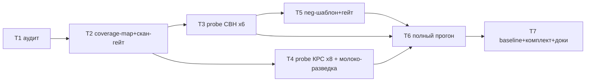

# Tasks: Животноводство — сценарии группового учёта СВН и КРС (спека 006)

> Requirements: @requirements.md
> Design: @design.md
> Status: **approved** (2026-10-31, «делай» — план T1–T7 утверждён, старт T1)

## Requirement Coverage

| Requirement | Tasks | Notes |
|---|---|---|
| FR-001 (скан+фикстуры) | T1, T2 | coverage-map записи |
| FR-002 (генерация в общий план) | T2 | поток без правок, проверка плана |
| FR-003 (skip с причиной) | T2, T6 | механика существует — верифицируем |
| FR-004 (батчи авторов + ФедоровБМ) | T2, T6 | авто-механика авторов |
| FR-005 (neg) | T5 | рецепт T5 спеки 005 |
| FR-006 (baseline единым действием) | T7 | |
| FR-007 (состав dist/) | T7 | только файлы сценариев |
| FR-008 (инструкция) | T7 | раздел животноводства |
| NFR-001 (чистота) | T2–T7 | данные, не код |
| NFR-002 (≤60 мин) | T6 | замер объединённого прогона |
| NFR-003 (пароли 3+) | T5, T6 | mismatch=[] |
| NFR-004 (переносимость) | T2, T7 | |
| TD-006 (сводный-молоко) | T4 | разведка на probe |

## Implementation Readiness Check

| Check | Status | Notes |
|---|---|---|
| Must Have requirements have tasks | Pass | FR-001..008 → T1..T7 |
| Requirements are covered by design | Pass | см. design §2 |
| Critical Questions are answered | Pass | Q-001..004 → D-002..005 |
| Tasks have dependencies, acceptance criteria, files, and verification | Pass | |
| Verification commands are known or marked manual/N/A | Pass | probes/runs — ручные VA-запуски (рецепты s005); офлайн-гейты — команды известны |

## Живые прогоны — общие правила (T3–T6)

- Десктоп **idle** (Chrome/мессенджеры закрыты) — жёсткий гейт (урок T8).
- UIA-флейк: 2 зонда, 2 разных шага = среда → стоп, эскалация.
- Probe = под админом, без подмены пароля, без записи (созданное удаляется).
- Критерий стабилизации шаблона: **2 зелёных probe подряд**.
- Зависание >2 мин без признаков работы → UIA-снимок окон.
- Все запуски VA — через python-лаунчер `scripts/s005_va_run.py`
  (dev-time, в комплект не входит); кириллица — только в tmp/*.txt.

## Task T1: Аудит метаданных 14 Must-типов (офлайн)

> СТАТУС: **ЗАКРЫТ 31.10.2026.** Артефакт tmp/s006/audit-fields.md (737 строк): 14 типов × fieldList шапки+ТЧ, типы полей, оси-кандидаты (СтатусЖивотных, УчетнаяГруппа, ВидОперации, ВводОстатков), ловушки форм (только КРС-Перевод ChoiceForm ×2; АпкПодборЖивотных в ФормахДокументов 14 типов не встречается). Ключевой факт: МестоСодержания = Склады (новый тип справочника экстрактору не нужен). Вывод: правка BSL на T2 не планируется.

**Priority:** P0
**Estimate:** 2–4 h
**Dependencies:** none
**Covers:** FR-001, TD-001

### Work
- [ ] Для 14 Must-типов (6 СВН + 8 КРС): состав реквизитов шапки и ТЧ
      по исходникам `C:\MyProjects\APKModSrc\Documents\<Тип>\` —
      черновики `fieldList.header/tabular`.
- [ ] Перечисления-оси (виды операций, виды взвешивания и пр.) — кандидаты
      `axes`/`valueMaps` по образцу растениеводства.
- [ ] Ловушки форм: формы подбора животных (АпкПодборЖивотных*),
      нестандартные поля выбора — список для probe (design §8).
- [ ] Фикстурные справочники (Свинокомплексы, Фермы, Корпуса, Секции,
      Партии, Статусы*) — сверка с данными разведки (36/36, counts).

### Acceptance Criteria
- [ ] `tmp/s006/audit-fields.md`: 14 типов × fieldList-черновик + оси +
      список ловушек форм. Читается read()-ом (UTF-8).

### Files
- `tmp/s006/audit-fields.md` — создать (dev-time артефакт)

### Verification
- [ ] Каждому из 14 типов сопоставлен fieldList-черновик; пробелы явно
      помечены «уточнить на probe».

## Task T2: coverage-map.json + скан-гейт (офлайн + COM-проба)

**Priority:** P0
**Estimate:** 1–2 h
**Dependencies:** T1
**Covers:** FR-001, FR-002, FR-003, FR-004, NFR-004

### Work
- [ ] Добавить 14 записей в `tests/coverage-map.json` → `documents`
      (template-имена по design §3.2, fieldList из T1).
- [ ] Заготовки-шаблоны `tests/templates/10-svn-*.feature` …
      `23-krs-*.feature` (минимальный каркас: заголовок сценария +
      placeholder-шаги; наполняются в T3/T4).
- [ ] COM-проба скана (headless): препроцессор-логика сканит 14 типов —
      все типы дают ≥1 представителя, авторы Орлов/Федоров в фикстурах,
      батч-план содержит ФедоровБМ.
- [ ] Проверка skip-ветки (FR-003): тип без данных → пропуск с причиной.

### Acceptance Criteria
- [ ] coverage-map валиден (JSON), старые 5 записей не изменены.
- [ ] Скан-план: 14 новых типов в плане, ФедоровБМ в батчах, old-план
      растениеводства не сломан (17 сценариев на месте).

### Files
- `tests/coverage-map.json` — изменить
- `tests/templates/1*-*.feature`, `2*-*.feature` — создать заготовки
- `scripts/probe_s006_scan.py` — создать (COM-проба, UTF-8 → tmp)

### Verification
- [ ] `python scripts/probe_s006_scan.py` → tmp/s006/scan-plan.txt:
      14 типов ≥1 документ, ФедоровБМ в users[], растениеводство 17.

## Task T3: Probe-волна СВН — 6 шаблонов

**Priority:** P0
**Estimate:** 4–8 h (6 шаблонов × probe-итерации)
**Dependencies:** T2
**Covers:** FR-001, FR-002, NFR-001

### Work
- [ ] По очереди (probe-first, playbook 01-pl-tractor):
      10-svn-farrowing (опорос, данных 21 — стартовый),
      11-svn-weighing, 12-svn-mortality, 13-svn-receipt,
      14-svn-movement, 15-svn-accounting-sheet.
- [ ] Каждый: probe-фича под админом → правка шаблона → повтор до
      2 зелёных подряд; грабли 8.5.4 — в шаблон/патчи, не в код.
- [ ] Патчи (если нужны) — в `tests/templates/scenario-patches.json`.
- [ ] Если экстрактор не читает тип поля (design §9) — точечная правка
      ObjectModule: bsl-ls 0 ошибок → сборка EPF → probe.

### Acceptance Criteria
- [ ] 6 шаблонов стабильно зелёные под админом (2× подряд каждый).
- [ ] Сгенерированные фичи воспроизводимы (повторная генерация — diff 0
      на неизменной базе).

### Files
- `tests/templates/1*-svn-*.feature` — наполнить
- `tests/templates/scenario-patches.json` — при необходимости
- `src/АпкПодготовкаСценарныхТестов/Ext/ObjectModule.bsl` — только если
  требуется экстрактору (гейт bsl-ls + epf-build)

### Verification
- [ ] Probe-логи: tmp/s006/probe-svn-*.txt (ReturnStatus=0 ×2 на шаблон).
- [ ] bsl-ls 0 ошибок при правке BSL; epf-build OK.

## Task T4: Probe-волна КРС/молоко — 8 шаблонов + сводный-молоко

**Priority:** P0
**Estimate:** 4–8 h
**Dependencies:** T2 (T3 — желательно ранее для переносимости граблей)
**Covers:** FR-001, FR-002, TD-006

### Work
- [ ] 8 шаблонов probe-first: 16-krs-milk-journal (надой, 31 — стартовый),
      17-krs-accounting-sheet, 18-krs-receipt, 19-krs-transfer,
      20-krs-weighing, 21-krs-calving, 22-krs-milk-ttn,
      23-krs-milk-internal.
- [ ] TD-006: разведка сводного-молока (оба не проведены) — журнал
      регистрации + попытка интерактивной записи под админом:
      рабочая механика → Should-шаблон в волну; патология → skip
      с причиной, в design/tasks — заметка.
- [ ] Патчи — как в T3.

### Acceptance Criteria
- [ ] 8 шаблонов стабильно зелёные (2× подряд каждый).
- [ ] Решение по сводному-молоку зафиксировано с уликой.

### Files
- `tests/templates/1*-krs-*.feature`, `2*-krs-*.feature` — наполнить
- `tests/templates/scenario-patches.json` — при необходимости
- `tmp/s006/milk-summary-recon.txt` — разведка TD-006

### Verification
- [ ] tmp/s006/probe-krs-*.txt (ReturnStatus=0 ×2 на шаблон).

## Task T5: Neg-шаблон животноводства + neg-гейт

**Priority:** P1
**Estimate:** 1–2 h
**Dependencies:** T3 (нужен стабильный опорос как neg-объект)
**Covers:** FR-005, NFR-003

### Work
- [ ] `tests/templates/neg-livestock-denied.feature`: neg-пользователь
      (генерируемый АпкСценТест_Негатив1, рецепт T5 спеки 005) пытается
      записать групповой опорос → ожидаемая ошибка прав → neg-passed.
- [ ] Neg-гейт: neg-only план — neg-passed=1, neg-failed=0, паритет
      MISSING = числу позитивных сценариев полного плана (рецепт
      t5-negrun).

### Acceptance Criteria
- [ ] Neg-гейт зелёный; вердикт-панель с neg-passed=1; маркеры паролей
      без «НЕ ВОССТАНОВЛЕН».

### Files
- `tests/templates/neg-livestock-denied.feature` — создать
- `tmp/s006/negrun/` — артефакты гейта

### Verification
- [ ] VA-прогон neg-плана: ReturnStatus=0, neg-passed=1, MISSING=полный
      план (17 растениеводство + 14 животноводство).

## Task T6: Объединённый полный прогон (живая приёмка)

**Priority:** P0
**Estimate:** 1–2 h (+ ~30–45 мин прогона)
**Dependencies:** T3, T4, T5
**Covers:** FR-004, NFR-002, NFR-003, FR-003 (skip-верификация в отчёте)

### Work
- [ ] Restore базы из dt (рецепт s005: jobs-deny, detached-restore,
      jobs-deny off) — свежие данные перед приёмкой.
- [ ] Neg-пользователь пересоздать (рецепт T5).
- [ ] Полный прогон: единый план (растениеводство + животноводство),
      idle-десктоп; ожидание: verdikt PASS, все сценарии зелёные,
      новые = NEW (до фиксации), регрессий 0 vs baseline, mismatch=[].
- [ ] Замер времени: NFR-002 ≤60 мин.

### Acceptance Criteria
- [ ] ReturnStatus=0; verdict PASS; passed = 17 старых + 14 новых
      (16+15 включая neg... точный состав — по факту плана), регрессий 0.
- [ ] mismatch=[]; время ≤60 мин.

### Files
- `tmp/s006/fullrun/` — артефакты; `tests/run-*/` — run-каталог

### Verification
- [ ] va_1c.log: Вердикт PASS, регрессий 0; summary.json: totals
      согласованны, passwords.mismatch=[].

## Task T7: Baseline + комплект + доки (закрытие спеки)

**Priority:** P1
**Estimate:** 1–2 h
**Dependencies:** T6
**Covers:** FR-006, FR-007, FR-008, NFR-004

### Work
- [ ] Зафиксировать эталон (действие раннера, зелёный прогон T6) →
      baseline.json расширен ключами животноводства.
- [ ] Контрольный прогон: регрессий 0, все ключи известны (NEW нет).
- [ ] dist/: пересобрать scenarios/ (шаблоны + патчи + baseline);
      состав комплекта неизменен (3 EPF + сценарии + ИНСТРУКЦИЯ).
- [ ] ИНСТРУКЦИЯ.md: раздел «Животноводство» (данные в базе, авторы
      Орлов/Соколов/Федоров, neg, время прогона).
- [ ] README (состав dist/ — обновить число файлов), INDEX/PLAN —
      статусы спеки 006; улики прогонов в docs/evidence/.
- [ ] Коммит + пуш.

### Acceptance Criteria
- [ ] Контрольный прогон: регрессий 0 vs нового baseline.
- [ ] dist/ актуален; ИНСТРУКЦИЯ дополнена; статусы закрыты.

### Files
- `dist/scenarios/*` — обновить; `dist/ИНСТРУКЦИЯ.md` — изменить
- `README.md`, `.ai/sdd/INDEX.md`, `.ai/sdd/PLAN.md` — статусы
- `docs/evidence/s006-*/` — улики

### Verification
- [ ] Контрольный VA-прогон зелёный (регрессий 0); `ls dist/` состав
      соответствует README.

## Dependency Diagram

## Implementation Slices

- **MVP Slice:** T1+T2+T3+T5 — свинокомплекс под регресс (US-1 частично,
  US-3 полностью); независимая валидация: СВН-прогон зелёный.
- **Финальный Slice:** T4+T6+T7 — полный контур + приёмка + комплект.
