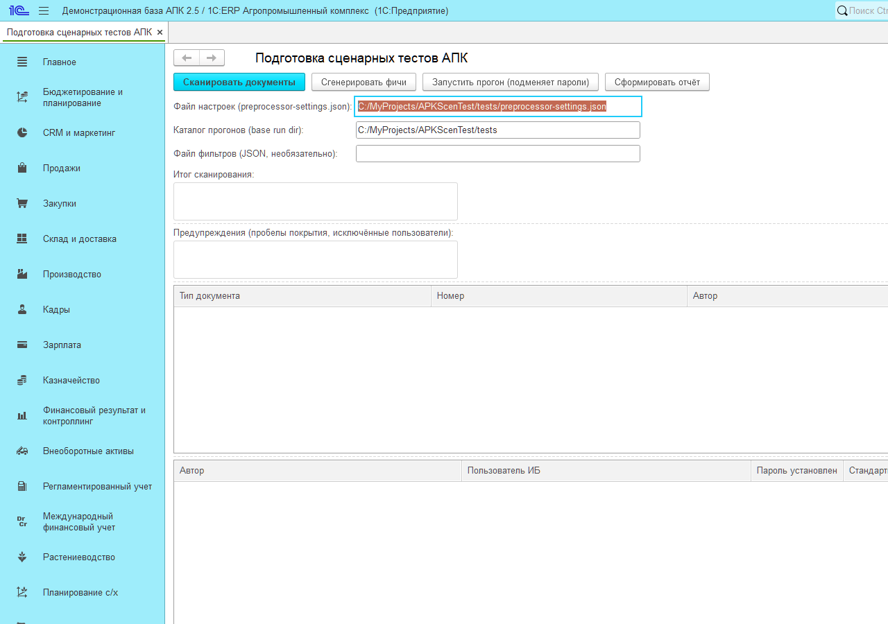
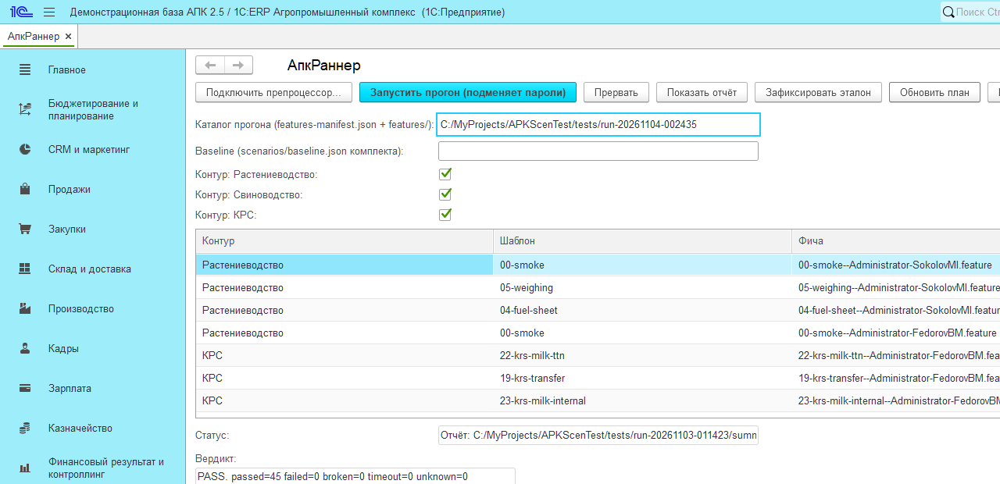
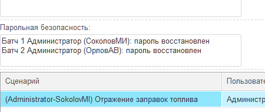

# Быстрый старт: сценарная проверка 1С:ERP+АПК 2.5

Полная версия — в `РУКОВОДСТВО-ОПЕРАТОРА.md` (тот же каталог).

## Чеклист перед стартом

- [ ] Windows, 1С:Предприятие 8.5 (8.5.4+), тестируемая база 1С:ERP+АПК 2.5
- [ ] Компонента **VanessaExt** установлена, расширение **VAExtension** подключено к базе
- [ ] Есть **3 свободные лицензии** на время прогона (раннер + менеджер + клиент)
- [ ] Пользователи-авторы тестовых документов **не работают в базе** (их пароли временно подменяются)
- [ ] Фоновые/регламентные задания отключены
- [ ] Бэкап базы сделан своими средствами (комплект меняет данные: проводит тестовые документы)
- [ ] Заполнен файл настроек `preprocessor-settings.json` (пути к `1cv8c.exe` и `vanessa-automation-single.epf`, строка базы, админ)

## Четыре шага

1. **Препроцессор.** Откройте в базе `АпкПодготовкаСценарныхТестов.epf`, укажите файл настроек и каталог прогонов → **«Сканировать документы»** → **«Сгенерировать фичи»**. Получится каталог `run-<дата>-<время>/` с `features-manifest.json`.

   

2. **Раннер.** Откройте `АпкРаннер.epf` → **«Подключить препроцессор...»** → укажите **Каталог прогона** (`run-*`) и **Baseline** (эталон; можно оставить пустым — сравнение будет `n/a`) → **«Обновить план»** → снимите флажки ненужных контуров.

   

3. **Прогон.** **«Запустить прогон (подменяет пароли)»** → подтвердите («Прогон подменит пароли авторов... Продолжить?» — Да). Статус покажет «Батч N/M (пользователь): mm:ss». Длительность: группа — от 1 до ~11 минут, полный прогон — десятки минут.

4. **Отчёт.** По завершении отчёт показывается на форме автоматически (или **«Показать отчёт»** в любой момент).

   

## Как читать вердикт

- **PASS (= ГОДЕН)** — нет провалов (`failed/broken/timeout/unknown/neg-failed`) **и** все пароли с ЗОД восстановлены. Иначе **FAIL (= НЕ ГОДЕН)** с числами.
- Строка вердикта: `passed=N failed=N ... neg-passed=N`, ниже — сравнение с эталоном (`регрессий N vs baseline <имя>` или `baseline не задан - сравнение n/a`).
- Колонка **vs baseline**: `=` без изменений, `REGRESSION` было пройдено → провал (главный сигнал), `IMPROVED` наоборот, `NEW` нет в эталоне, `MISSING` сценарий исчез.
- Панель «Парольная безопасность»: по каждой группе проверок — «пароль восстановлен» либо «ПАРОЛЬ НЕ ВОССТАНОВЛЕН!» (это сразу FAIL).

## Если вердикт красный

1. Откройте `run-*/summary.md` и `logs/` в каталоге прогона.
2. `failed`-строки смотрите в таблице отчёта (сценарий × пользователь × статус) и в `allure/`.
3. Типовые причины — таблица «Частые проблемы» в `РУКОВОДСТВО-ОПЕРАТОРА.md` (приложение Б) и `ИНСТРУКЦИЯ.md` §4.
4. Прогон можно повторить: **«Запустить прогон»** по тому же каталогу (создаст новую сводку).
