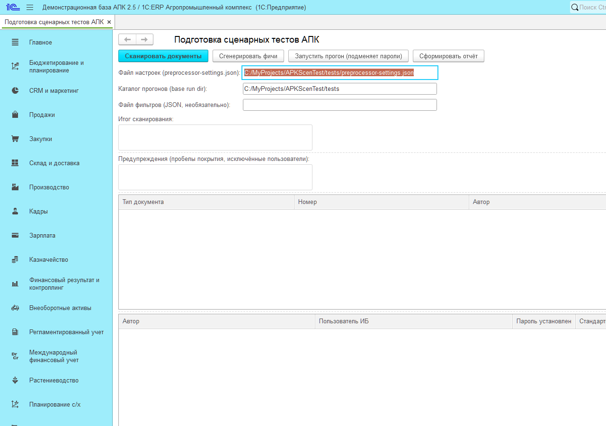
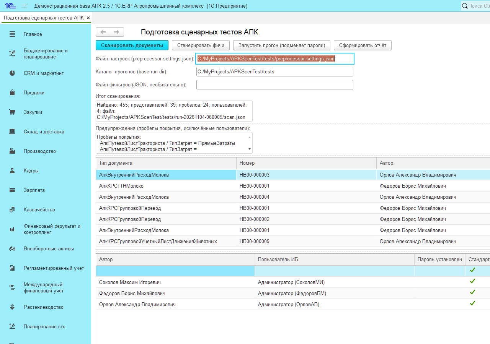
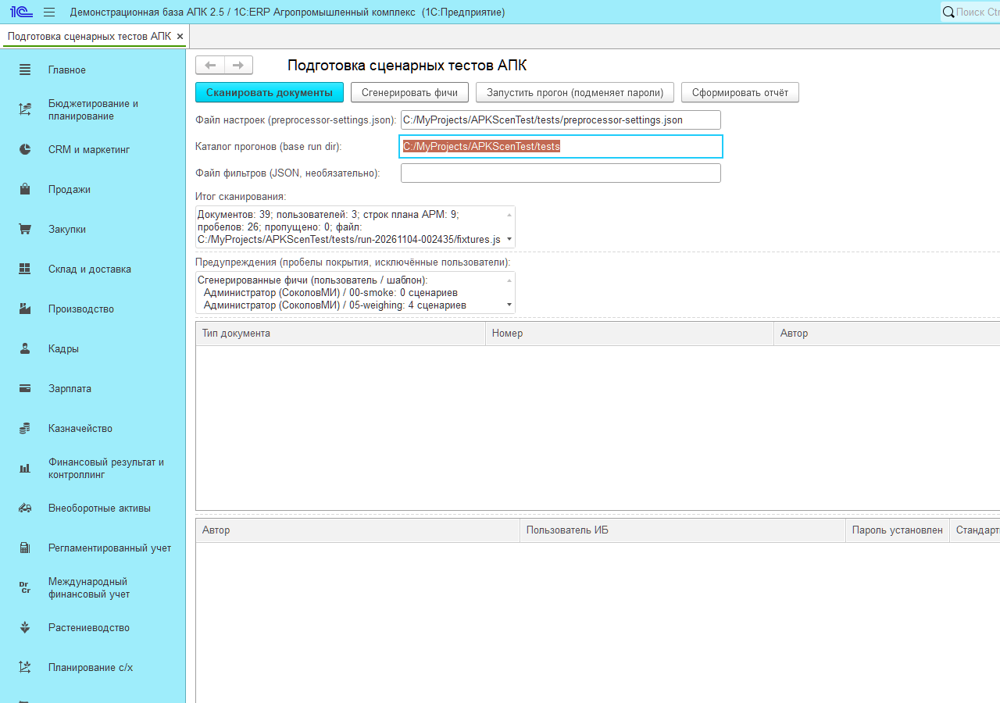
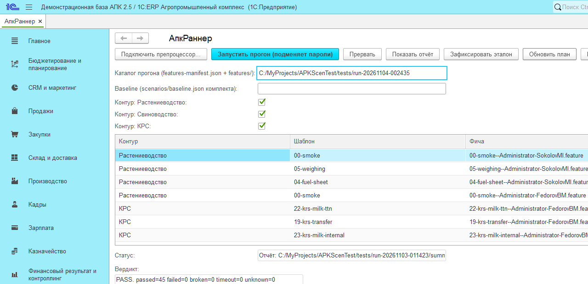
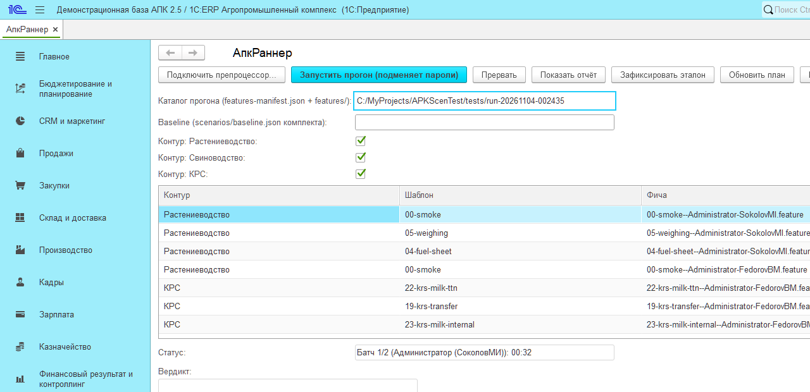
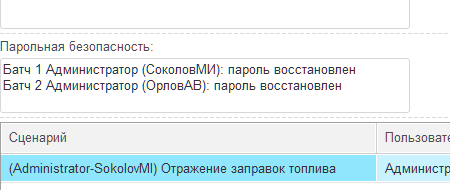
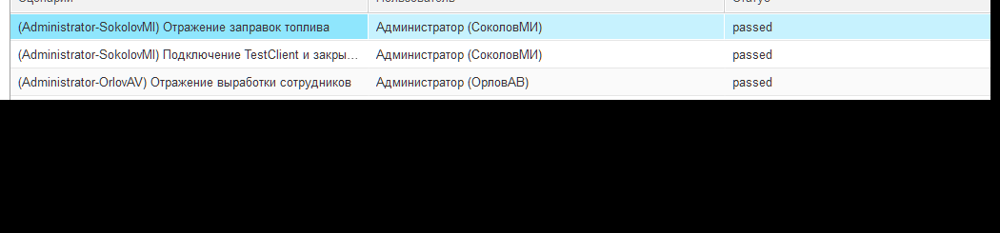
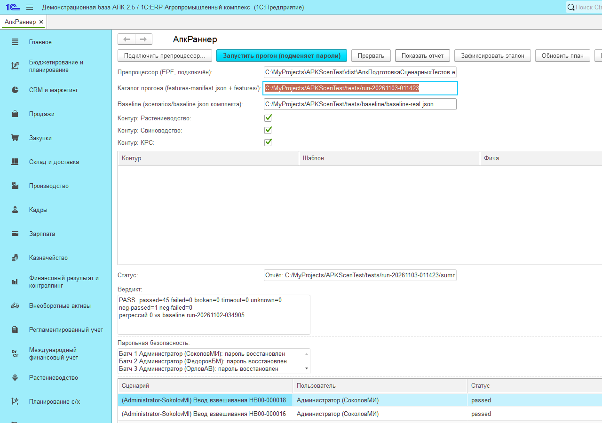

# Руководство оператора: сценарная проверка 1С:ERP+АПК 2.5

Кому адресовано: оператору, который на сторонней базе заказчика должен
подготовить окружение, настроить и запустить сценарный прогон и
разобрать отчёт. Всё делается **только средствами 1С:Предприятия** —
никакого python и внешних инструментов не требуется.

Краткая версия — `БЫСТРЫЙ-СТАРТ.md`. Словарь терминов — приложение А.

---

## 1. О комплекте

Комплект воспроизводит **реальные документы** базы (растениеводство,
свинотоварные фермы, молочный КРС, АРМ-цепочки), найденные в базе
сканированием, и повторяет их **от имени авторов этих документов**.
Поэтому проверка всерьёз покрывает права и ограничения доступа, а не
только механику заполнения форм. Итоги сводятся в общий отчёт и
сверяются с эталоном (baseline) — «какая проверка под каким
пользователем прошла».

Принцип работы и схемы — `docs/how-tester-works.md` в репозитории
проекта (в комплект не входит).

### Состав комплекта (`dist/`)

| Файл/каталог | Назначение |
|---|---|
| `АпкПодготовкаСценарныхТестов.epf` | Препроцессор: скан базы, фикстуры, генерация .feature |
| `АпкРаннер.epf` | Раннер: цикл групп проверок Vanessa, подмена/восстановление паролей, отчёт-форма, сравнение с эталоном |
| `vanessa-automation-single.epf` | Vanessa Automation single (запускается раннером) |
| `scenarios/` | Шаблоны .feature, `scenario-patches.json`, `baseline.json` / `baseline-real.json` |
| `ИНСТРУКЦИЯ.md` | Техническая инструкция (среда, порядок, типовые проблемы) |
| `screenshots/` | Скриншоты форм, на которые ссылается это руководство |

### Совместимость

- **Платформа**: 1С:Предприятие 8.5 (проверено на 8.5.4.1683), **Windows**.
  Linux не поддерживается (механика раннера использует Windows-shell).
- **Тестируемая база**: 1С:ERP+АПК 2.5 (стенд проекта — PostgreSQL,
  сервер `localhost`; допустима и файловая база).
- **VanessaExt**: компонента должна быть установлена на стенде заранее,
  до прогона; комплектом не устанавливается.
- **Расширение VAExtension**: подключено к базе, роль
  `VAExtension_ОбщиеПрава`.

---

## 2. Как подготовить

### Требования к машине и базе

- **Лицензии**: на время группы проверок нужны минимум **3
  одновременных сеанса** (сеанс раннера + TestManager + TestClient).
  Симптом нехватки — группы падают со статусом `connect`.
- **Порты**: от `portBase+1` и выше — по одному на группу, должны быть
  свободны (осиротевшие клиенты раннер чистит сам).
- **Дамп/откат базы — своими средствами** (dt/cf, штатный бэкап).
  Комплект не делает ни дампа, ни отката и **меняет данные базы**:
  проводит/удаляет тестовые документы, временно меняет пароли
  пользователей-авторов.
- **Пользователи-авторы не работают в базе** во время прогона: пароль
  каждого автора временно подменяется на тестовый на время его группы.
  Автор, зашедший в базу во время прогона, получит отказ авторизации.
- **Фоновые/регламентные задания отключить** (мешают монопольным
  операциям и занимают сеансы).
- **Негативные сценарии**: в базе должны существовать 5 ролей
  neg-пользователя (АдминистраторСистемы, БазовыеПраваБСП,
  ЗапускТонкогоКлиента, ИнтерактивноеОткрытиеВнешнихОтчетовИОбработок,
  VAExtension_ОбщиеПрава).

### Учётная запись

Препроцессор и раннер открываются в тестируемой базе под
администратором (`adminUser` из настроек — он же запускает TestManager).

### Чеклист перед первым запуском

- [ ] VanessaExt установлена, VAExtension подключено
- [ ] 3 свободные лицензии, свободные порты от `portBase+1`
- [ ] Авторы предупреждены, фоновые задания отключены
- [ ] Бэкап базы сделан
- [ ] `preprocessor-settings.json` заполнен и лежит в доступном месте

---

## 3. Как настроить

Файл настроек `preprocessor-settings.json` указывается в поле
**«Файл настроек (preprocessor-settings.json)»** формы препроцессора:

| Ключ | Смысл |
|---|---|
| `infoBase` | строка подключения к базе (`Srvr="host";Ref="name"` или файловая) |
| `v8cPath` | путь к `1cv8c.exe` платформы |
| `vaEpfPath` | путь к `vanessa-automation-single.epf` |
| `adminUser` / `adminPassword` | администратор TestManager (запускает Vanessa) |
| `timeoutMinutesPerBatch` | таймаут одной группы проверок; с животноводством рекомендуется 25 мин |
| `portBase` | базовый порт TestClient (порт группы = `portBase` + номер) |
| `clientType` / `webUrl` | «Тонкий» (по умолчанию) или «Web» + URL публикации |
| `alwaysSubstitutePwd` | подмена пароля «всегда» (режим реальных авторов) |
| `projectDir`, `runsBaseDir` | каталог проекта и базовый каталог прогонов |
| `templatesDir`, `coverageMapPath`, `smokeTemplate`, `maxTabularRows` | шаблоны, карта покрытия, smoke-шаблон, лимиты генерации |
| `negUser`, `negTemplate` | негативный пользователь и его шаблон |

**Безопасность паролей.** Пароли авторов неизвестны комплекту и не
хранятся: на время группы проверок платформенный хэш пароля автора
сохраняется в память, ставится временный тестовый пароль (один
случайный на прогон), после группы — **при любом исходе, включая
прерванную** — исходное значение возвращается. Поле «Парольная
безопасность» формы отчёта показывает маркер по каждой группе.
Хэши паролей в файлы артефактов не пишутся.

---

## 4. Как запускать

Всё выполняется в одной базе; скриншоты ниже сняты на реальном стенде.

### Шаг 1. Препроцессор: скан базы

Откройте `АпкПодготовкаСценарныхТестов.epf` под администратором:

1. Укажите **«Файл настроек (preprocessor-settings.json)»** и
   **«Каталог прогонов (base run dir)»** (где создавать каталоги `run-*`).
   При необходимости — **«Файл выборки (JSON, необязательно)»**.
2. Кнопка **«Сканировать документы»** создаёт каталог
   `run-<дата>-<время>/` с `run.json` и `scan.json`. В таблице формы —
   найденные представители по типам документов и их авторы, в поле
   **«Итог сканированных»** — сводка (сколько найдено документов,
   представителей, пользователей), в поле **«Предупреждения»** —
   пробелы покрытия и исключённые пользователи.

Каталог `run-*` — рабочая папка всего прогона: `run.json`, `scan.json`,
`fixtures.json`, `features/`, `features-manifest.json`, `params/`,
`logs/`, `allure/`, `batches.json`, `summary.json`/`summary.md`.

### Шаг 2. Фикстуры и .feature-фичи

Кнопка **«Сгенерировать фичи»** (после скана): фикстуры
(`fixtures.json`) → сценарии `features/` + `features-manifest.json` с
применением патчей `scenarios/scenario-patches.json`. Итог генерации —
в поле **«Итог»** (документов, пользователей, строк плана АРМ, покрыто /
пропущено) и списке **«Сгенерированные (пользователь / шаблон)»**.

Без `features-manifest.json` раннер откажется стартовать с явным
сообщением. Прерванная генерация (например, битый
`scenario-patches.json`) выводит в форму понятную ошибку с путём файла.

### Шаг 3. Раннер: форма и план прогона

Откройте `АпкРаннер.epf` в той же базе и сеансе:

1. **«Подключить препроцессор...»** — выберите
   `АпкПодготовкаСценарныхТестов.epf` (серверная механика прогона;
   поле «Препроцессор (EPF, подключён)» заполнится).
2. **«Каталог прогона (features-manifest.json + features/)»** — каталог
   `run-*` после шага 2.
3. **«Baseline (scenarios/baseline.json комплекта)»** — файл эталона:
   реальные авторы — `baseline-real.json`, зондовый режим —
   `baseline.json`. Пусто — сравнение будет `n/a`.
4. Кнопка **«Обновить план»** строит таблицу «План прогона» по
   `features-manifest.json` (колонки Контур / Шаблон / Фича /
   Пользователь / Neg / Включён).
5. Отбор: флажки **«Контур: Растениеводство / Свиноводство / КРС»** и
   кнопки **«Включить выделенные» / «Исключить выделенные»**.

   - Превью показывает **все строки манифеста** — это норма: флажки не
     удаляют строки, а переключают колонку «Включён» (Да/Нет);
     фильтрация реально применяется при сборке групп — по кнопке
     запуска.
   - «Исключить/Включить выделенные» — точечное управление по ключу
     `шаблон--пользователь`.
   - Выбор автоматически сохраняется в `tests/test-selection.json`
     (структура `Контуры` + `Отключены`) и переживает перезапуск формы.

### Шаг 4. Прогон

Кнопка **«Запустить прогон (подменяет пароли)»** → вопрос
«Прогон подменит пароли авторов на время батчей и восстановит их
после. Продолжить?» — **Да** → цикл групп проверок. Статус формы:
«Батч N/M (пользователь): mm:ss».

Для каждой группы: подмена пароля автора → параметры Vanessa → запуск
`1cv8c /TESTMANAGER` с `vanessa-automation-single.epf` → ожидание до
`timeoutMinutesPerBatch` → принудительное завершение по таймауту →
**восстановление пароля при любом исходе** → чтение вердикта Vanessa →
удаление временных файлов с паролем. Если автор группы = админ
TestManager, пароль менеджера тоже подменяется (иначе менеджер
зависает).

**«Прервать»** — завершить текущую группу, восстановить пароль и
остановить прогон. Закрытие формы во время прогона делает то же самое.

Ожидаемое время: генерация — секунды; одна группа — от 1 минуты
(neg) до ~11 минут (полный контур одного автора; поэтому таймаут группы
в настройках — 25 минут); полный прогон всех контуров — десятки
минут (зависит от числа авторов и сценариев).

---

## 5. Как читать отчёт

После финала (или кнопкой **«Показать отчёт»** по любому каталогу
прогона с `batches.json`) на форме раннера:

- **Вердикт** (панель): `PASS` (= ГОДЕН) / `FAIL` (= НЕ ГОДЕН) и числа:
  `passed / failed / broken / timeout / unknown / neg-passed /
  neg-failed`. PASS — это нули во всех «плохих» счётчиках **и**
  восстановленные пароли во всех группах. Следующей строкой —
  `регрессий N vs baseline <имя>` либо `baseline не задан - сравнение n/a`.
- **Парольная безопасность** (панель): по каждой группе — «пароль
  восстановлен» / «ПАРОЛЬ НЕ ВОССТАНОВЛЕН!» (последнее — сразу FAIL).
- **Таблица результатов**: Сценарий | Пользователь | Статус |
  **vs baseline** | Сек | Neg. Статусы: `passed / failed / broken /
  timeout / unknown`; для негативных сценариев (Neg): `neg-passed` =
  ожидаемый отказ доступа воспроизведён (это успех), `neg-failed` =
  негатив не сработал.

### Сравнение с эталоном

Колонка **vs baseline** считается по ключу (сценарий, пользователь):

| Метка | Смысл |
|---|---|
| `=` | без изменений |
| `REGRESSION` | было пройдено → провал (главный сигнал) |
| `IMPROVED` | было провалено → пройдено |
| `NEW` | сценария нет в эталоне |
| `MISSING` | сценарий исчез из прогона |

Регрессии = REGRESSION + MISSING. Пример вердикта полного прогона с
эталоном: `регрессий 0 vs baseline run-20261102-034905`.

### Файлы каталога прогона

`summary.json` (машиночитаемая сводка), `summary.md` (сводка для
человека), `batches.json` (исход групп), `allure/<сборка>/` (результаты
сценариев для просмотра), `logs/` (журналы Vanessa и 1С). Хэши паролей
в артефакты не пишутся.

### Типовые действия при провале

1. Откройте строку в таблице: сценарий × пользователь × статус.
2. В `logs/` — журнал группы (`1c-*.log`, `va-*.log`); в `allure/` —
   шаги сценария.
3. `failed` после обновления релиза → смотрите колонку vs baseline:
   REGRESSION/MISSING — кандидат на регресс.
4. Служебные причины (лицензии, порты, «админ = автор группы») —
   приложение Б и `ИНСТРУКЦИЯ.md` §4.
5. Повторный прогон — **«Запустить прогон»** по тому же каталогу.

### Зафиксировать эталон

Кнопка **«Зафиксировать эталон»** доступна только при вердикте PASS:
перезаписывает указанный baseline-файл результатами текущего прогона.
Старый эталон сохраните в git/историю вручную.

---

## Приложение А. Словарь терминов

| Термин | Значение |
|---|---|
| группа проверок (в логах — «батч», batch) | набор сценариев, выполняемый одним сеансом Vanessa под одним автором |
| полный прогон (гейт, gate) | прогон всех выбранных контуров с вердиктом ГОДЕН / НЕ ГОДЕН |
| эталон (baseline) | сохранённый образец результатов для сравнения |
| регресс | расхождение результата с эталоном после обновления |
| ReturnStatus | код завершения сеанса проверки (0 = прошла) |
| neg-сценарий / neg-пользователь | отказная проверка и пользователь без прав (ожидаемый отказ = успех) |
| Вердикт PASS / FAIL | ГОДЕН / НЕ ГОДЕН |
| smoke | короткая группа «самопроверки» стенда (шаблон `00-smoke`) |
| контур | группа шаблонов по разделу АПК: Растениеводство, Свиноводство, КРС (+ АРМ-цепочки) |
| TestManager / TestClient | служебные сеансы платформы: исполнитель Vanessa и управляемый клиент |

## Приложение Б. Частые проблемы

| Симптом | Причина / действие |
|---|---|
| Группа висит до таймаута, 0-байтовые логи | админ TestManager = автор группы, пароль не подменён; нехватка лицензий |
| Статус группы `connect` | нет лицензий/сеансов, Vanessa не поднялась; смотреть `logs/1c-*.log` |
| «Недостаточно прав» у neg-пользователя = `neg-passed` | это успех, не ошибка |
| Порт TestClient занят | осиротевший клиент; раннер чистит сам; при ручном зависании — остановить процесс через диспетчер задач |
| Каталог прогона без `features-manifest.json` | не выполнена генерация фич (шаг 2 раздела 4) |
| «План прогона» показывает все строки при снятом флажке контура | норма: смотрите колонку «Включён» (Нет) — в прогон эти строки не попадут |
| Эксклюзивные операции (загрузка dt, обновление конфигурации БД) не начинаются | в базе активные сеансы (в т. ч. фоновые); закрыть сеансы, отключить регламентные задания. **Никогда не прерывайте загрузку из dt принудительно** — это разрушает информационную базу |
| Раннер не стартует: «Укажите каталог прогона» | не заполнено или не зафиксировано поле «Каталог прогона» — щёлкните по другому полю после ввода пути |
