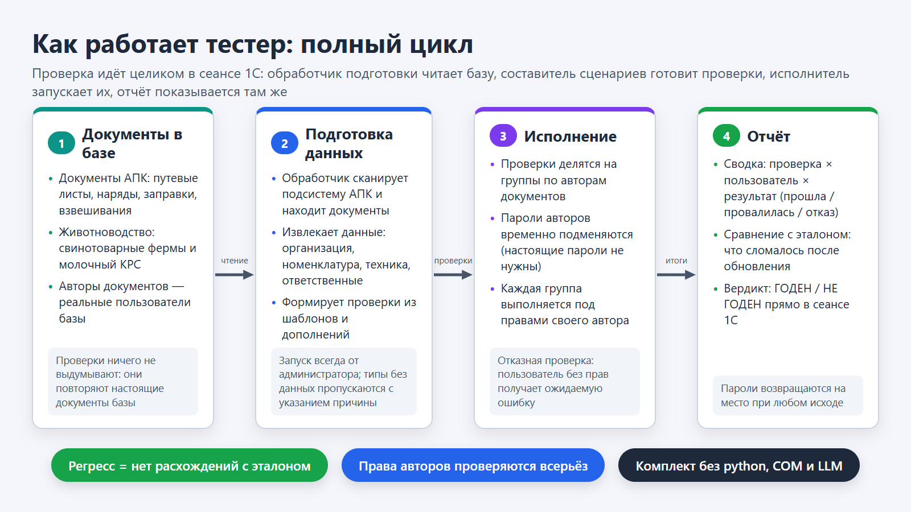
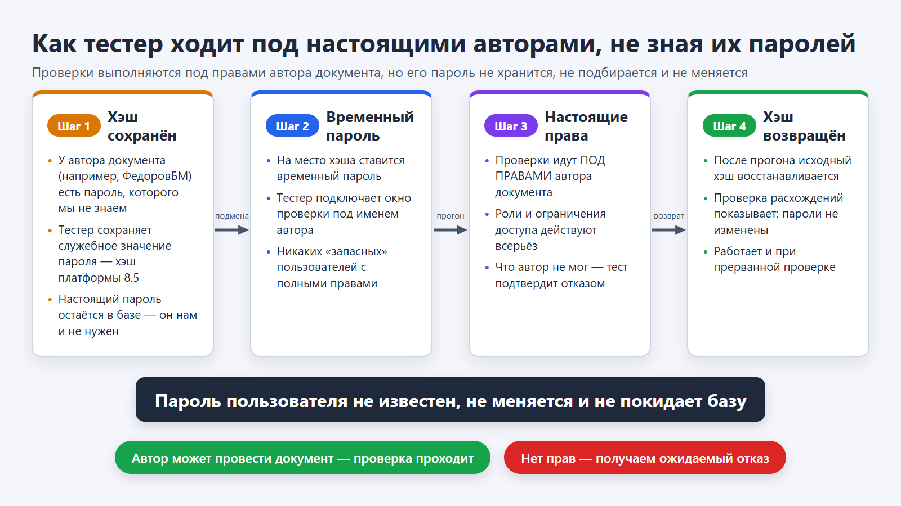
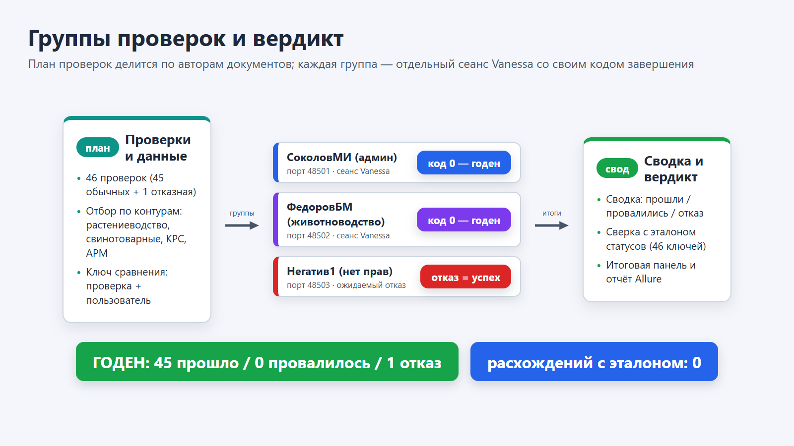
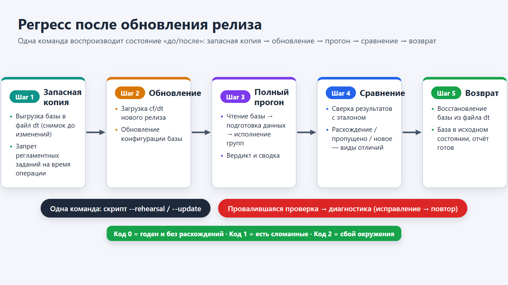

# Как работает тестер (наглядно)

Эта страница объясняет принцип работы тестера простым языком, на схемах.
Если в других документах проекта встречаются английские слова («батч»,
«гейт», «baseline» и т. п.) — здесь каждый термин переведён и пояснён.

> Технический комментарий для разработчика: картинки нарисованы
> генератором на основе Remotion (`tools/remotion-docs/`). Правится
> файл сцен `src/diagrams.tsx`, затем перегенерация:
> ```bash
> cd tools/remotion-docs
> npm install
> npx remotion still src/index.ts TesterPipeline ../../docs/diagrams/TesterPipeline.png
> # то же для TesterPasswords / TesterBatches / TesterRegression
> ```

## 1. Полный цикл: от документов до вердикта

Проверка идёт целиком в сеансе 1С: обработчик подготовки читает базу,
составитель сценариев готовит проверки, исполнитель запускает их,
отчёт показывается там же.



**Что важно:** тесты ничего не выдумывают — они воспроизводят реальные
документы АПК (растениеводство, свинотоварные фермы, молочный КРС),
найденные обработчиком подготовки, и выполняют их **от имени авторов
этих документов**. Поэтому проверка регресса всерьёз покрывает права и
ограничения доступа, а не только механику заполнения форм.

## 2. Механизм паролей: автор настоящий, пароль неизвестен

Ключевая особенность: проверки идут под реальными пользователями базы,
хотя их пароли нам неизвестны и не хранятся.



Тестер сохраняет служебное значение пароля (хэш платформы 8.5), ставит
временный пароль, прогоняет проверки и **всегда** возвращает исходное
значение — включая прерванную проверку. Проверка расхождений
подтверждает: ни один пароль пользователя не изменён.

## 3. Группы проверок и вердикт

План проверок делится на группы по авторам документов. Каждая группа —
отдельный сеанс Vanessa со своим кодом завершения, портом и набором
сценариев. Итоги сводятся в общий отчёт и сверяются с эталоном.



Эталон — это результат «какая проверка под каким пользователем прошла».
Поэтому одна и та же проверка под разными авторами даёт разные записи
сравнения. Отказная проверка («Негатив1» без прав) работает наоборот:
ожидаемый отказ = успех теста.

## 4. Регресс после обновления релиза

Одна команда воспроизводит состояние «до/после»: запасная копия базы →
обновление → полный прогон → сравнение с эталоном → возврат базы
в исходное состояние. Запускается скриптом `regress_run.py` (работа
с python — это служебная обвязка для разработчика, в сам комплект
она не входит).



Коды завершения скрипта: `0` — годен и без расхождений, `1` — есть
сломанные проверки, `2` — сбой окружения (запасная копия, обновление,
возврат, начальная проверка). Провалившаяся проверка попадает в
диагностическую петлю (см. `manual-start-and-new-base.md`):
наблюдение → исправление шаблона → повторный прогон.

## Словарь терминов

| Как встречается в проекте | Что это значит |
|---|---|
| батч (batch) | группа проверок, выполняемая одним сеансом под одним автором |
| гейт (gate) | полный прогон с вердиктом ГОДЕН / НЕ ГОДЕН |
| ReturnStatus | код завершения сеанса проверки (0 = прошла) |
| summary.json | итоговый файл сводки: прошли / провалились / отказ |
| baseline (эталон) | сохранённый образец результатов для сравнения |
| neg-сценарий, neg-пользователь | отказная проверка и пользователь без прав |
| регресс | расхождение результата с эталоном после обновления |
| E2E (сквозной) | полный прогон от чтения базы до вердикта |
| rehearse / rehear­sal | прогон без обновления («репетиция») |
| update | прогон с применением обновления релиза |
