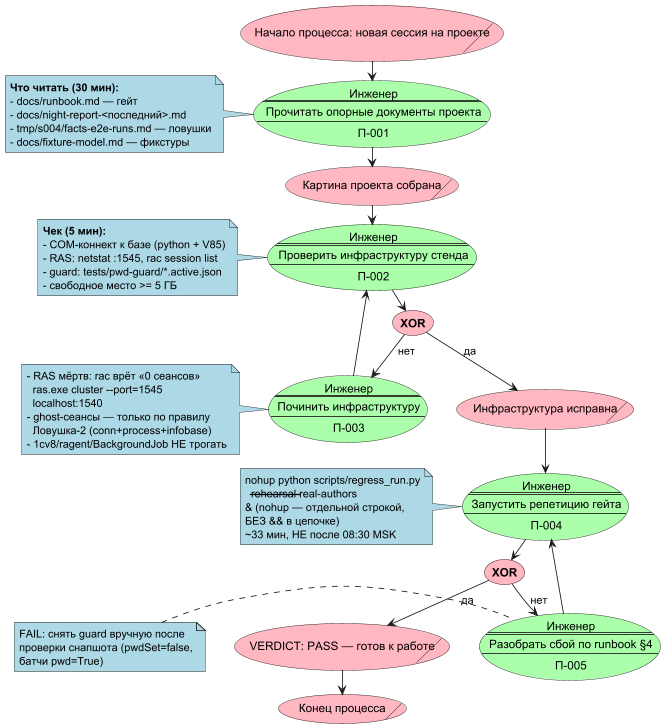
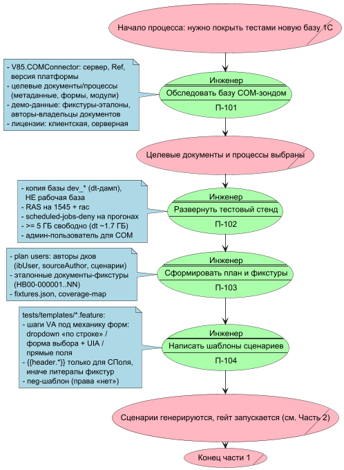
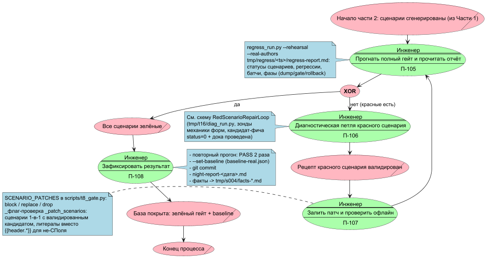
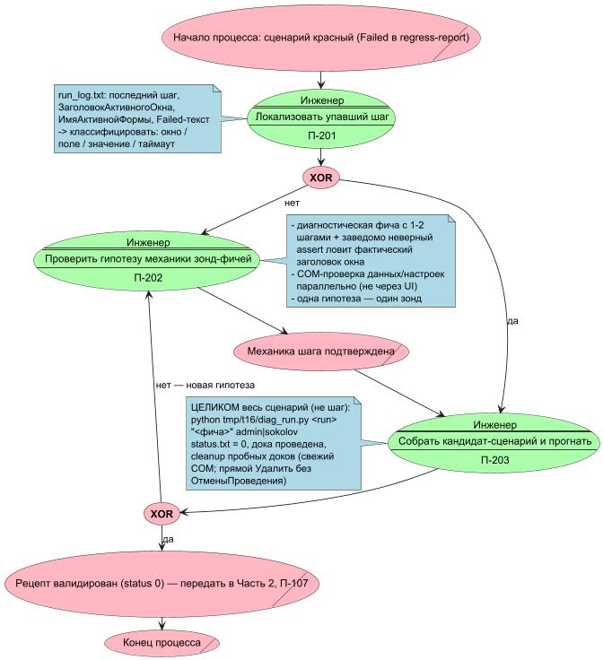

# Пользовательская инструкция: как начинать и как покрыть тестами новую базу

Для инженера, который впервые открывает проект `APKScenTest`, и для
постановщика, которому нужно посадить этот фреймворк на **новую базу 1С**.
Схемы процессов — PlantUML, eEPC-диалект (правила и стиль — по образцу
`c:\MyProjects\MyTasks\ДокументыКакКод`): функции зелёные с исполнителем и
кодом П-NNN, события розовые, условия **XOR**, сверху вниз. Исходники схем —
`docs/diagrams/*.puml`, картинки перегенерировать:

```bash
cd docs/diagrams
java -jar c:/Users/r.edokov/Downloads/plantuml.jar -tpng -charset UTF-8 *.puml
```

---

## Часть 1. Как начинать (первая сессия на проекте)



### Шаг 1. Прочитать опорные документы (~30 мин)

| Документ | Что даёт |
|---|---|
| `docs/runbook.md` | как устроен и запускается гейт, чтение отчёта, действия при сбоях |
| `docs/night-report-<последняя дата>.md` | актуальное состояние: что зелёное, что чинили последней ночью |
| `tmp/s004/facts-e2e-runs.md` | летопись фактов и ловушек, полученных «кровью» — читать обязательно |
| `docs/fixture-model.md` | модель фикстур: эталонные документы, роли реквизитов |

### Шаг 2. Проверить инфраструктуру (~5 мин)

```bash
# COM-коннект к базе (обязателен перед любым батчем)
python -c "import win32com.client; \
  c=win32com.client.Dispatch('V85.COMConnector').Connect(\
  \"Srvr='localhost';Ref='dev_erpapk_demo';Usr='Администратор (ОрловАВ)'\"); print('OK')"

# RAS жив? (мёртвый RAS = rac МОЛЧА врёт «0 сеансов»!)
netstat -ano | grep ":1545"
"C:/Program Files/1cv8/8.5.4.1683/bin/rac.exe" session list \
  --cluster=67cdef87-7bfc-4dae-b8e4-3ea9f8529156

# guard-файлы парольной подмены (после PASS снимаются сами, после FAIL — вручную)
ls tests/pwd-guard/*.active.json || echo "guard чист"
```

### Шаг 3. Репетиция гейта (~33 мин)

```bash
nohup python scripts/regress_run.py --rehearsal --real-authors > tmp/gate.log 2>&1 &
```

**Внимание:** `nohup ... &` — отдельной строкой, НЕ в цепочке с `&&`
(иначе вся цепочка уходит в фон и молча умирает, лог 0 байт). Не запускать
гейт после ~08:30 MSK (окно подмены паролей авторов).

### Шаг 4. Разбор результата

Отчёт: `tmp/regress/<timestamp>/regress-report.md` — статусы сценариев,
сравнение с baseline, регрессии, фазы (dump → gate → rollback). **VERDICT:
PASS** — можно работать; FAIL — действовать по `docs/runbook.md §4` (и не
забыть проверить снапшот guard и снять его вручную).

---

## Часть 2. Карта проекта (что где лежит)

| Каталог / файл | Роль |
|---|---|
| `scripts/regress_run.py` | оркестратор: дамп → гейт → откат → отчёт |
| `scripts/t8_gate.py` | генератор фич, `SCENARIO_PATCHES`, проверки гейта |
| `tests/templates/*.feature` | шаблоны сценариев (по одному на вид документа) + neg-шаблон |
| `tests/run-*/` | сгенерированные по фиксурам прогоны (features, fixtures.json, логи) |
| `tests/baseline/baseline-real.json` | эталон статусной сетки для сравнения |
| `tests/pwd-guard/` | guard-файлы подмены паролей (инвариант безопасности) |
| `tmp/regress/<ts>/` | отчёты прогонов (regress-report.md) |
| `tmp/t16/` | диагностическая мастерская (diag_run.py, зонды-фичи) |
| `tmp/s004/facts-*.md` | база фактов (ловушки, корни, рецепты) |
| `docs/night-*.md` | планы и отчёты ночных сессий |

Сценарный цикл: **фикстуры → генерация фич из шаблонов → патчи
(`SCENARIO_PATCHES`) → гейт (батчи Vanessa под реальными авторами + neg)
→ сравнение с baseline → откат базы → отчёт**.

---

## Часть 3. Покрыть тестами новую базу

Главный процесс — две части: подготовка и доведение до зелёного.





### Ключевые решения Части 1 (подготовка)

1. **Обследование COM-зондом** — не глазами в конфигуратор, а скриптом:
   платформа, сервер, целевые документы (метаданные/формы/модули — читаются
   из XML-исходников выгрузки), демо-данные. Сразу проверить лицензии
   (клиентскую и серверную) — мёрвая лицензия валяет весь стенд (см. отчёт
   T17).
2. **Стенд — только копия базы** (`dev_*`), никогда рабочая. Гейт сам делает
   dt-дамп перед прогоном и откат после; эксклюзив требует свободных сеансов
   (фоновые задания глушатся `scheduled-jobs-deny` автоматически).
3. **План пользователей = реальные авторы эталонных документов** (RLS/права
   проверяются «в бою»), плюс отдельный neg-пользователь с заведомо
   снятыми правами на один вид документа.
4. **Шаблоны пишутся под механику КОНКРЕТНЫХ форм**: dropdown «по строке»
   (динамический поиск платформы), форма выбора + UIA (только если окно
   реально открывается), прямые поля с «я перехожу к следующему реквизиту».
   `{{header.*}}`-подстановки работают не для всех документов — для
   не-СПоля только литералы фикстур.

### Ключевые решения Части 2 (доведение)

1. **Один красный сценарий — одна диагностическая петля** (схема ниже):
   локализация шага → зонд гипотезы → кандидат-сценарий целиком (status 0 +
   документ проведён) → патч в `SCENARIO_PATCHES` → офлайн-проверка
   `_patch_scenarios` → повторный гейт.
2. **Патчи — это данные, не правка сгенерированных фич**: ops `block` /
   `replace` / `drop` в `scripts/t8_gate.py` применяются к baseline-фиче при
   каждой генерации. Офлайн-проверка обязана показать сценарии 1-в-1 с
   валидированным кандидатом ДО запуска гейта.
3. **Фиксация**: PASS дважды → `--set-baseline` → git commit →
   night-report. Факты и рецепты — в `tmp/s004/facts-*.md`.



---

## Ловушки (топ-10, все получены кровью — летопись в `tmp/s004/facts-*.md`)

1. **RAS мёртв → rac молча врёт** «0 сеансов». Перед прогонами проверять
   `netstat :1545`; старт: `ras.exe cluster --port=1545 localhost:1540`
   (НЕ 1541).
2. **НЕ kill процессы 1cv8/ragent/BackgroundJob**. Ghost-сеансы снимать
   только по правилу «conn+process+infobase в одном блоке».
3. **Guard после FAIL не снимается сам** — проверить снапшот (`pwdSet=false`,
   батчи `pwd=True`) и снять вручную ДО следующего запуска.
4. **Не гонять гейт после ~08:30 MSK** — окно подмены паролей авторов.
5. **COM-проверка коннекта обязательна** перед любым батчем.
6. **Кириллица в bash-heredoc манглится** — python-скрипты через
   `u'''...'''` или `io.open(..., encoding='utf-8')`; сравнивать байты, не
   отображение; `***` в выводе = редактура, не литерал.
7. **nohup-ловушка**: `cmd && nohup python ... &` уносит всю цепочку в фон —
   запускать отдельной строкой.
8. **Текст в составное поле = dropdown-яд**: ввод текста в поле с
   выпадающим списком ломает форму каскадом; после ввода весов всегда
   «я перехожу к следующему реквизиту».
9. **Платформенный баг удаления тестовых документов**: «закрытый менеджер
   временных таблиц» лечится прямым `Удалить()` без `ОтменыПроведения` в
   свежем COM-коннекте.
10. **`ВЫБРАТЬ ПЕРВЫЕ N` — до «ИЗ»**, не в конце запроса; rac-вывод — cp866;
    taskkill в git-bash — `//PID`.

## Шпаргалка команд

```bash
# Полный гейт (репетиция, реальные авторы, ~33 мин)
nohup python scripts/regress_run.py --rehearsal --real-authors > tmp/gate.log 2>&1 &

# Гейт + фиксация эталона (только после PASS дважды!)
nohup python scripts/regress_run.py --rehearsal --real-authors --set-baseline ...

# Диагностическая фича (зонд/кандидат): 0 в status.txt = успех
python tmp/t16/diag_run.py <runname> "<абс. путь>.feature" admin|sokolov

# Офлайн-проверка патчей (до гейта!)
python -c "import importlib.util as u; s=u.spec_from_file_location('t8','scripts/t8_gate.py'); \
  m=u.module_from_spec(s); s.loader.exec_module(m); \
  print(m._patch_scenarios('<фича-копия>', m.SCENARIO_PATCHES['05-weighing']))"

# Сеансы кластера
"C:/Program Files/1cv8/8.5.4.1683/bin/rac.exe" session list \
  --cluster=67cdef87-7bfc-4dae-b8e4-3ea9f8529156

# Отчёт последнего прогона
ls -t tmp/regress/ | head -2   # затем <ts>/regress-report.md
```
